# Animal artwork collection

100 individual full-body illustrations: the original 36 and the 64-species menagerie
pack. The cheetah remains the shared style reference. All 100 source PNGs live in
`originals/` and stay outside the public site. Original files are retained byte for byte;
no missing image has been substituted or fabricated during integration.

The runtime serves three transparent WebP variants per species at 96, 192 and 384 px.
The original 36 retain their previous framing. The 64 additions fit a 300 px silhouette
inside a 384 px square with a 342 px baseline; every derivative is checked for a clear
10% border. The manifest records source and derivative SHA-256 hashes and byte sizes.
The validator checks exact roster coverage, extra files, decoding and transparency.
It does not certify species anatomy.

**Strict source-art acceptance is blocked.** All 64 supplied source PNGs contain low
alpha noise in the requested border, and most have tight visible framing. The original
36 are preserved under their prior acceptance. The normalization of runtime padding
does not repair source PNGs or settle fine toe, hidden-limb or segment counts. See the
[integration audit](../../docs/integration-audit.md) and the
[per-image preparation review](../../expansion/review/artwork-review.json).

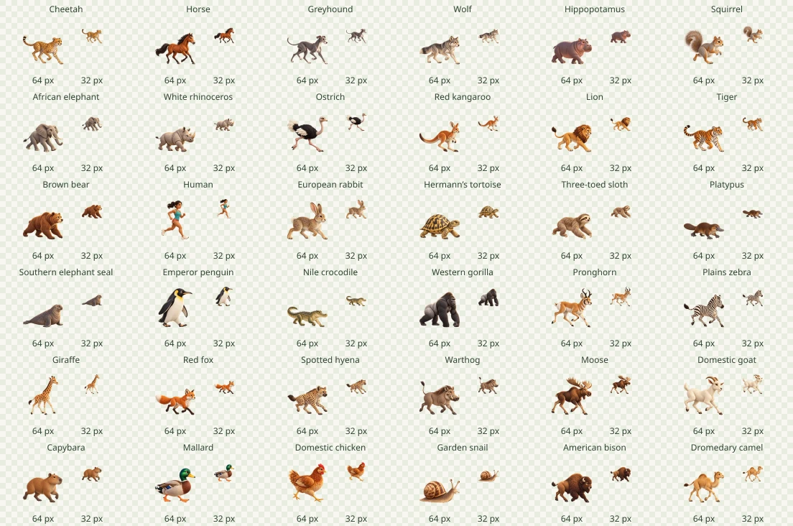

Run from the repository root:

```bash
npm run roster:sync
npm run roster:check
npm run assets:build
npm run assets:check
npm run assets:review
```

The review command refreshes the committed collection preview, the complete 64/32 px
contact sheet and 17 detail sheets in ignored `test-results/animal-art/`. Original-size
review sheets and a viewer are retained in `expansion/review/`; their links now point
to the production source directory. Art direction and 100 anatomical briefs live in
`art-direction.json`. The manifest supplies measured collection byte totals.

| Competitor                   | 64 px                                                                                                                  | 32 px                                                                                                                 | Original PNG                                               |
| ---------------------------- | ---------------------------------------------------------------------------------------------------------------------- | --------------------------------------------------------------------------------------------------------------------- | ---------------------------------------------------------- |
| Cheetah                      | 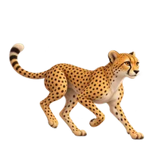                               | 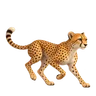                               | [cheetah.png](originals/cheetah.png)                       |
| Horse                        | 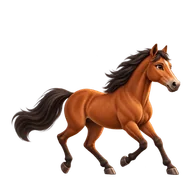                                   | 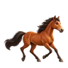                                   | [horse.png](originals/horse.png)                           |
| Greyhound                    | 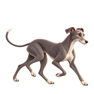                           | 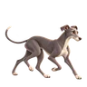                           | [greyhound.png](originals/greyhound.png)                   |
| Wolf                         | 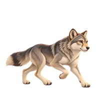                                     | 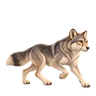                                     | [wolf.png](originals/wolf.png)                             |
| Hippopotamus                 | 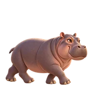                            | 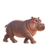                            | [hippo.png](originals/hippo.png)                           |
| Squirrel                     | 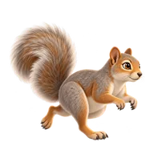                             | 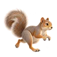                             | [squirrel.png](originals/squirrel.png)                     |
| African elephant             | 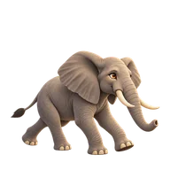                     | 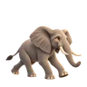                     | [elephant.png](originals/elephant.png)                     |
| White rhinoceros             | 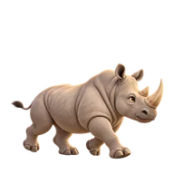                        | 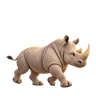                        | [rhino.png](originals/rhino.png)                           |
| Ostrich                      | 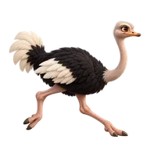                               | 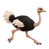                               | [ostrich.png](originals/ostrich.png)                       |
| Red kangaroo                 | 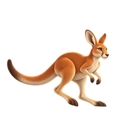                         | 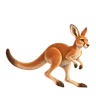                         | [kangaroo.png](originals/kangaroo.png)                     |
| Lion                         | 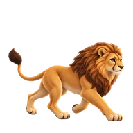                                     | 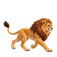                                     | [lion.png](originals/lion.png)                             |
| Tiger                        | 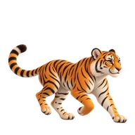                                   | 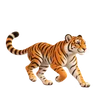                                   | [tiger.png](originals/tiger.png)                           |
| Brown bear                   | 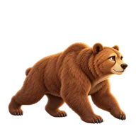                               | 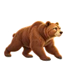                               | [bear.png](originals/bear.png)                             |
| Human                        |                                    |                                    | [human.png](originals/human.png)                           |
| European rabbit              | 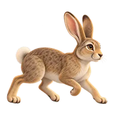                        | 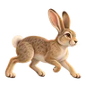                        | [rabbit.png](originals/rabbit.png)                         |
| Hermann’s tortoise           | 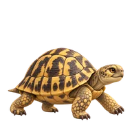                   | 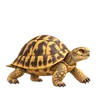                   | [tortoise.png](originals/tortoise.png)                     |
| Three-toed sloth             | 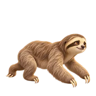                        | 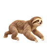                        | [sloth.png](originals/sloth.png)                           |
| Platypus                     | 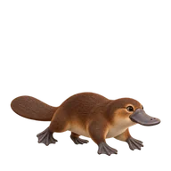                             | 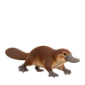                             | [platypus.png](originals/platypus.png)                     |
| Southern elephant seal       | 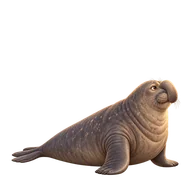                   | 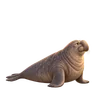                   | [seal.png](originals/seal.png)                             |
| Emperor penguin              | 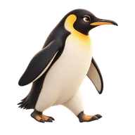                       | 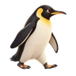                       | [penguin.png](originals/penguin.png)                       |
| Nile crocodile               | 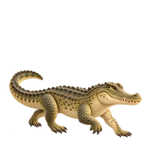                      | 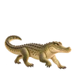                      | [crocodile.png](originals/crocodile.png)                   |
| Western gorilla              | 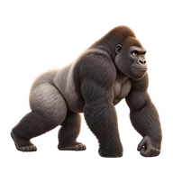                       | 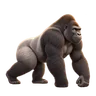                       | [gorilla.png](originals/gorilla.png)                       |
| Pronghorn                    | 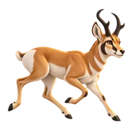                           | 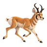                           | [pronghorn.png](originals/pronghorn.png)                   |
| Plains zebra                 | 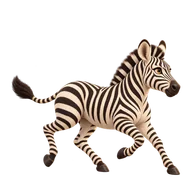                            | 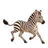                            | [zebra.png](originals/zebra.png)                           |
| Giraffe                      | 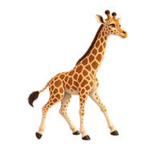                               | 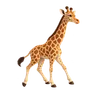                               | [giraffe.png](originals/giraffe.png)                       |
| Red fox                      | 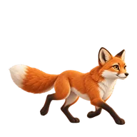                                   |                                    | [fox.png](originals/fox.png)                               |
| Spotted hyena                |                            |                            | [hyena.png](originals/hyena.png)                           |
| Warthog                      |                                |                                | [warthog.png](originals/warthog.png)                       |
| Moose                        |                                    |                                    | [moose.png](originals/moose.png)                           |
| Domestic goat                |                             |                             | [goat.png](originals/goat.png)                             |
| Capybara                     |                              |                              | [capybara.png](originals/capybara.png)                     |
| Mallard                      |                                   |                                   | [duck.png](originals/duck.png)                             |
| Domestic chicken             |                       |                       | [chicken.png](originals/chicken.png)                       |
| Garden snail                 |                             |                             | [snail.png](originals/snail.png)                           |
| American bison               |                           |                           | [bison.png](originals/bison.png)                           |
| Dromedary camel              |                          |                          | [camel.png](originals/camel.png)                           |
| Quokka                       |                                  |                                  | [quokka.png](originals/quokka.png)                         |
| Common wombat                |                           |                           | [wombat.png](originals/wombat.png)                         |
| Temminck's pangolin          |                   |                   | [pangolin.png](originals/pangolin.png)                     |
| Aardvark                     |                              |                              | [aardvark.png](originals/aardvark.png)                     |
| Short-beaked echidna         |                   |                   | [echidna.png](originals/echidna.png)                       |
| Nine-banded armadillo        |                |                | [armadillo.png](originals/armadillo.png)                   |
| Giant anteater               |                  |                  | [giant-anteater.png](originals/giant-anteater.png)         |
| Meerkat                      |                                |                                | [meerkat.png](originals/meerkat.png)                       |
| European badger              |                         |                         | [badger.png](originals/badger.png)                         |
| Wolverine                    |                            |                            | [wolverine.png](originals/wolverine.png)                   |
| Raccoon                      |                                |                                | [raccoon.png](originals/raccoon.png)                       |
| Red panda                    |                            |                            | [red-panda.png](originals/red-panda.png)                   |
| Fossa                        |                                    |                                    | [fossa.png](originals/fossa.png)                           |
| Ring-tailed lemur            |            |            | [ring-tailed-lemur.png](originals/ring-tailed-lemur.png)   |
| Olive baboon                 |                      |                      | [olive-baboon.png](originals/olive-baboon.png)             |
| Crested porcupine            |            |            | [crested-porcupine.png](originals/crested-porcupine.png)   |
| European hedgehog            |                     |                     | [hedgehog.png](originals/hedgehog.png)                     |
| Tailless tenrec              |                         |                         | [tenrec.png](originals/tenrec.png)                         |
| Common shrew                 |                             |                             | [shrew.png](originals/shrew.png)                           |
| Black and rufous sengi       |          |          | [elephant-shrew.png](originals/elephant-shrew.png)         |
| South African springhare     |            |            | [springhare.png](originals/springhare.png)                 |
| Okapi                        |                                    |                                    | [okapi.png](originals/okapi.png)                           |
| Southern cassowary           |                   |                   | [cassowary.png](originals/cassowary.png)                   |
| Emu                          |                                        |                                        | [emu.png](originals/emu.png)                               |
| Secretary bird               |                  |                  | [secretary-bird.png](originals/secretary-bird.png)         |
| Greater roadrunner           |                  |                  | [roadrunner.png](originals/roadrunner.png)                 |
| North Island brown kiwi      |                   |                   | [kiwi.png](originals/kiwi.png)                             |
| Wild turkey                  |                        |                        | [wild-turkey.png](originals/wild-turkey.png)               |
| Helmeted guineafowl          |                 |                 | [guineafowl.png](originals/guineafowl.png)                 |
| Indian peafowl               |                         |                         | [peafowl.png](originals/peafowl.png)                       |
| Red-legged seriema           |                     |                     | [seriema.png](originals/seriema.png)                       |
| Kori bustard                 |                      |                      | [kori-bustard.png](originals/kori-bustard.png)             |
| Great tinamou                |                          |                          | [tinamou.png](originals/tinamou.png)                       |
| Superb lyrebird              |                       |                       | [lyrebird.png](originals/lyrebird.png)                     |
| Komodo dragon                |                    |                    | [komodo-dragon.png](originals/komodo-dragon.png)           |
| Gila monster                 |                      |                      | [gila-monster.png](originals/gila-monster.png)             |
| Central bearded dragon       |          |          | [bearded-dragon.png](originals/bearded-dragon.png)         |
| Frilled lizard               |                  |                  | [frilled-lizard.png](originals/frilled-lizard.png)         |
| Texas horned lizard          |              |              | [horned-lizard.png](originals/horned-lizard.png)           |
| Thorny devil                 |                      |                      | [thorny-devil.png](originals/thorny-devil.png)             |
| Eastern blue-tongued skink   |  |  | [blue-tongued-skink.png](originals/blue-tongued-skink.png) |
| Leopard gecko                |                    |                    | [leopard-gecko.png](originals/leopard-gecko.png)           |
| Tuatara                      |                                |                                | [tuatara.png](originals/tuatara.png)                       |
| Rosy boa                     |                              |                              | [rosy-boa.png](originals/rosy-boa.png)                     |
| Common toad                  |                        |                        | [common-toad.png](originals/common-toad.png)               |
| Fire salamander              |                |                | [fire-salamander.png](originals/fire-salamander.png)       |
| Tiger salamander             |              |              | [tiger-salamander.png](originals/tiger-salamander.png)     |
| Tomato frog                  |                        |                        | [tomato-frog.png](originals/tomato-frog.png)               |
| Ornate horned frog           |          |          | [ornate-horned-frog.png](originals/ornate-horned-frog.png) |
| Golden mantella              |                |                | [golden-mantella.png](originals/golden-mantella.png)       |
| Chilean rose tarantula       |               |               | [tarantula.png](originals/tarantula.png)                   |
| Emperor scorpion             |                      |                      | [scorpion.png](originals/scorpion.png)                     |
| Coconut crab                 |                      |                      | [coconut-crab.png](originals/coconut-crab.png)             |
| Six-spotted tiger beetle     |          |          | [tiger-beetle.png](originals/tiger-beetle.png)             |
| Saharan silver ant           |                  |                  | [silver-ant.png](originals/silver-ant.png)                 |
| Madagascar hissing cockroach |         |         | [cockroach.png](originals/cockroach.png)                   |
| European mantis              |                         |                         | [mantis.png](originals/mantis.png)                         |
| Indian stick insect          |               |               | [stick-insect.png](originals/stick-insect.png)             |
| Giant African millipede      |        |        | [giant-millipede.png](originals/giant-millipede.png)       |
| Giant desert centipede       |               |               | [centipede.png](originals/centipede.png)                   |
| Common earthworm             |                     |                     | [earthworm.png](originals/earthworm.png)                   |
| Black slug                   |                                |                                | [slug.png](originals/slug.png)                             |
| Solórzano's velvet worm      |            |            | [velvet-worm.png](originals/velvet-worm.png)               |
| Common rough woodlouse       |               |               | [woodlouse.png](originals/woodlouse.png)                   |
